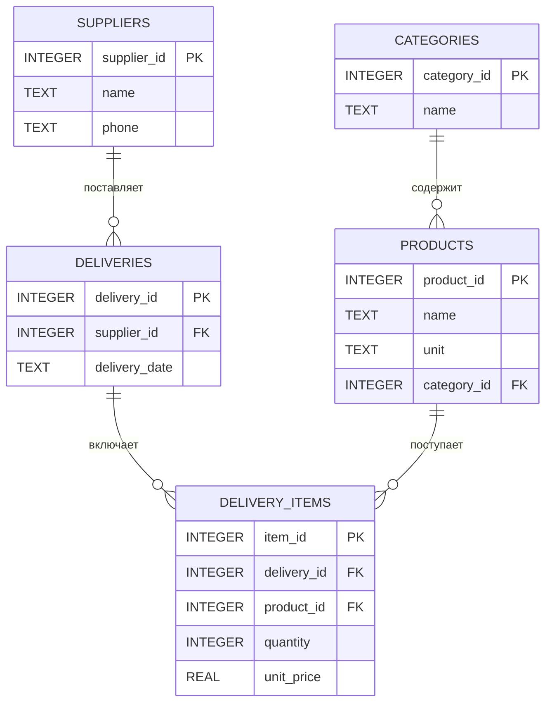

# Система учёта склада продуктов

## О проекте

Проект посвящён разработке системы учёта склада продуктов. Она должна помогать контролировать остатки товаров, сроки годности и движение продукции между зонами хранения.

> **Текущий этап:**  реализовано подключение SQLite и создание структуры базы данных из файла schema.sql. Программа выводит остатки товаров по категориям. Поступления, перемещения, списания, инвентаризация и отчёты пока находятся в планах.

## Цель системы

Обеспечить точный учёт остатков, контроль сроков годности, прозрачность движения товаров и формирование отчётности.

## Основные задачи

- регистрировать поступление товаров и связывать его с накладными;
- фиксировать перемещения товаров между зонами и складами;
- учитывать списания из-за брака, просрочки или внутреннего потребления;
- вести справочники номенклатуры и партий;
- формировать отчёты по остаткам и оборотам;
- проводить инвентаризацию и фиксировать расхождения.

## Роли пользователей

| Роль | Основные обязанности |
|---|---|
| Кладовщик | Приёмка, размещение и перемещение товаров, списание, инвентаризация |
| Менеджер по закупкам | Работа с номенклатурой, заказы поставщикам, анализ остатков и оборачиваемости |
| Бухгалтер | Проверка первичных документов и формирование итоговых отчётов |
| Администратор | Регистрация пользователей и назначение прав доступа |

## Архитектура

Для системы планируется использовать трёхуровневую архитектуру.

| Уровень | Назначение |
|---|---|
| **Presentation Layer** | Консольное меню, ввод данных, навигация, вывод отчётов и уведомлений |
| **Business Logic Layer** | Правила учёта, контроль сроков годности, расчёт остатков и проверка ячеек |
| **Data Layer** | Чтение и запись файлов, целостность данных и журналирование операций |

**Планируемый язык программирования:** Python.  
**Планируемое хранение данных:** файлы.

## Диаграммы

### Диаграмма вариантов использования


### Блок-схема процесса приёмки товара


### Блок-схема процесса списания товара


## ER-диаграмма



## Запуск текущего примера

Установите Python, откройте корневую папку проекта в терминале и выполните:

```bash
python src/warehouse/main.py
```